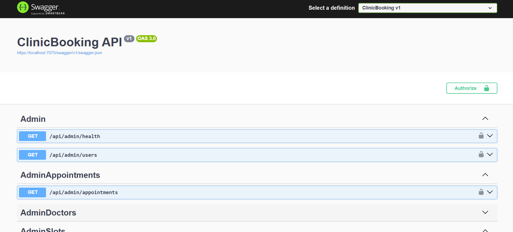
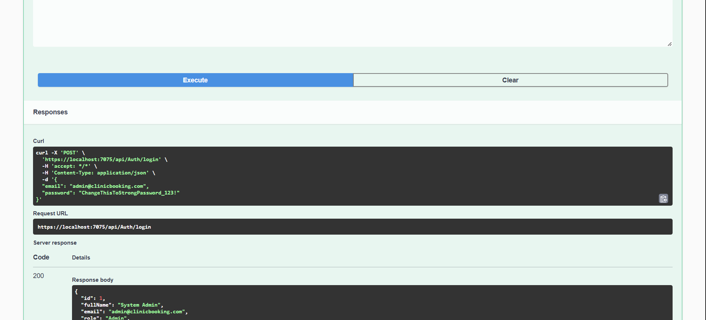
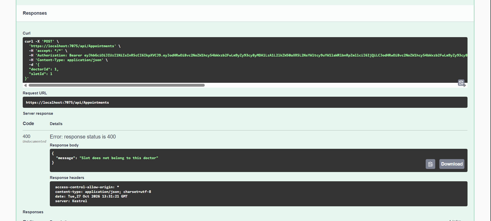
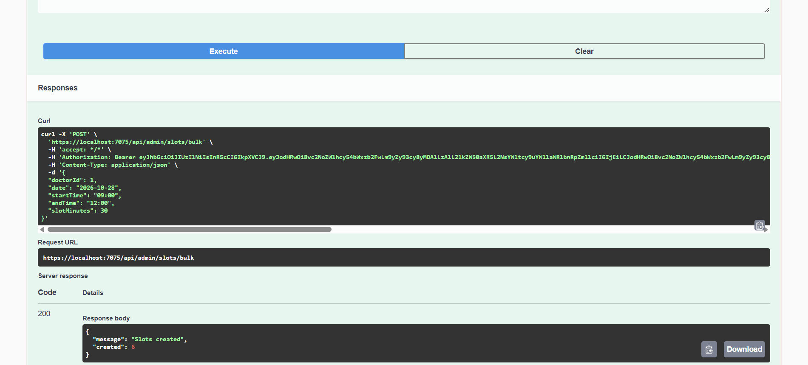

# ClinicBooking API

[](https://github.com/BatoolQarqash/clinic-booking-api/actions/workflows/ci.yml)

A clinic appointment booking backend built with **ASP.NET Core 8 Web API**, **Entity Framework Core** and **SQL Server**. Patients browse medical services and doctors, see available time slots, and book or cancel appointments. Admins manage doctors, generate availability slots, and review all bookings.

**Demo:** run it locally with Docker in two commands (see [Getting Started](#getting-started)). Screenshots and a short walkthrough are below.


https://github.com/user-attachments/assets/27f610bb-fc9f-412b-8b85-fc0db2c765ab


## Screenshots

| Swagger overview | Login (JWT) |
|---|---|
|  |  |

| Book an appointment | Admin: generate slots |
|---|---|
|  |  |

---

## Features

**Authentication & authorization**
- Register and login with JWT bearer tokens
- Role-based access (`User`, `Admin`) using `[Authorize(Roles = "Admin")]`
- Passwords hashed with PBKDF2 (SHA-256, 100,000 iterations, random salt) and checked with a constant-time comparison

**Patients**
- Browse medical services (Dentistry, Cardiology, Neurology, …)
- List active doctors, filter by service and search by name or title
- Top-rated doctors endpoint
- View doctor details and available slots for a given date
- Book an appointment:
  - slots in the past are rejected
  - the slot must belong to the selected doctor
  - double booking returns `409 Conflict`, backed by a filtered unique index on the slot (active appointments only)
- View own appointments
- Cancel an appointment (blocked within 1 hour of the start time); the slot becomes bookable again and the cancelled row is kept as history

**Admins**
- Doctors: create, update, get, list, soft delete (`IsActive = false`)
- Doctor photo upload (`.jpg`, `.jpeg`, `.png`, `.webp`, max 3 MB), stored under `wwwroot/uploads/doctors`
- Generate slots in bulk for a day from start time, end time and slot length (5–240 min); existing slots are skipped
- Delete slots: `409` if the slot has a booked or completed appointment; cancelled appointment rows are removed together with the slot
- List all appointments with pagination and filters (status, doctor, user email, date range)
- List registered users

**Platform**
- Global exception middleware that returns a ProblemDetails-style JSON with a `traceId` (no internal details outside Development)
- EF Core migrations and seed data (services, sample doctors, initial admin) applied automatically on startup
- Swagger / OpenAPI with JWT "Authorize" support
- Docker image and `docker-compose.yml` (API + SQL Server 2022)
- Optional vanilla HTML/CSS/JS frontend in [`frontend/`](frontend/) (landing page, doctors, booking, favorites, admin dashboard)

## Tech Stack

| Area | Technology |
|------|------------|
| Runtime | .NET 8, ASP.NET Core Web API |
| Data | Entity Framework Core 8, SQL Server (2022 in Docker) |
| Auth | JWT Bearer (`Microsoft.AspNetCore.Authentication.JwtBearer`), PBKDF2 hashing |
| API docs | Swashbuckle (Swagger / OpenAPI) |
| DevOps | Docker, Docker Compose |
| Frontend (optional) | HTML, CSS, vanilla JavaScript |

## Architecture

```
ClinicBooking/
├── Controllers/        HTTP endpoints (public, user, admin)
├── Services/           Business logic: AppointmentService (book/cancel rules), SlotService (bulk slot generation)
├── Data/               AppDbContext (indexes, relationships), design-time factory for EF tools
├── Models/             Entities: User, Service, Doctor, AvailabilitySlot, Appointment
├── DTOs/               Request models with DataAnnotations validation (Auth, Appointments, Admin)
├── Auth/               JwtTokenService, PasswordHasher (PBKDF2)
├── Middlewares/        ExceptionHandlingMiddleware (global error handling)
├── Seed/               DbSeeder: services, sample doctors, initial admin from configuration
├── Migrations/         EF Core migrations (SQL Server)
├── wwwroot/uploads/    Uploaded doctor images (served as static files)
├── frontend/           Optional static frontend that calls the API
├── Program.cs          DI, JWT, Swagger, CORS, migrations + seeding at startup
├── Dockerfile
└── docker-compose.yml
```

**Request flow:** `Controller → Service (booking/slot rules) → AppDbContext → SQL Server`. Simple read endpoints query `AppDbContext` directly from the controller.

**Data model:** a `Service` has many `Doctor`s. A `Doctor` has many `AvailabilitySlot`s. An `Appointment` links a `User`, a `Doctor` and one `AvailabilitySlot`. Unique indexes: `User.Email`, `Appointment.SlotId` (filtered to non-cancelled appointments), and `(AvailabilitySlot.DoctorId, StartTime)`.

## Getting Started

### Option A: Docker (API + SQL Server)

Requirements: Docker Desktop.

```bash
cp .env.example .env
# edit .env and set SA_PASSWORD, JWT_KEY (and optionally ADMIN_EMAIL / ADMIN_PASSWORD)
# generate a JWT key on one line:  openssl rand -base64 64 | tr -d '\n'

docker compose up --build
```

- API: http://localhost:8080
- Swagger: http://localhost:8080/swagger (when `ENABLE_SWAGGER=true`)

The API runs migrations on startup. If SQL Server is not ready yet, the container exits and restarts (`restart: on-failure`) until it can connect.

### Option B: Local (.NET SDK + your own SQL Server)

Requirements: .NET 8 SDK and a SQL Server instance (LocalDB, Developer edition, or `docker run` of `mcr.microsoft.com/mssql/server:2022-latest`).

Secrets are never stored in `appsettings.json`. Use [user secrets](https://learn.microsoft.com/aspnet/core/security/app-secrets) for local development:

```bash
dotnet user-secrets set "ConnectionStrings:DefaultConnection" "Server=localhost,1433;Database=ClinicBookingDb;User Id=sa;Password=<YOUR_SA_PASSWORD>;TrustServerCertificate=True"
dotnet user-secrets set "Jwt:Key" "<at least 32 random bytes, e.g. openssl rand -base64 64>"

# optional: initial admin account
dotnet user-secrets set "Admin:Email" "admin@example.com"
dotnet user-secrets set "Admin:Password" "<ADMIN_PASSWORD>"

dotnet run --launch-profile https
```

Swagger opens at https://localhost:7075/swagger. The database is created and seeded on first run.

### Running tests

```bash
dotnet test tests/ClinicBooking.Tests
```

The tests in [`tests/ClinicBooking.Tests`](tests/ClinicBooking.Tests) run the booking and slot services against the real `AppDbContext` on an in-memory SQLite database, so unique indexes and foreign keys are enforced, and use a fake clock for the time rules. No SQL Server or secrets are needed. CI runs them on every push and pull request to `main`.

**Frontend (optional):** serve the `frontend/` folder with any static server (for example the VS Code Live Server extension) and open `frontend/pages/landing.html`. The API base URL is set in [`frontend/js/config.js`](frontend/js/config.js).

## Configuration

All settings can be provided through `appsettings.json`, user secrets, or environment variables. Environment variables use `__` (double underscore) in place of `:`. See [`appsettings.example.json`](appsettings.example.json) and [`.env.example`](.env.example).

| Environment variable | Config key | Required | Description |
|---|---|---|---|
| `ConnectionStrings__DefaultConnection` | `ConnectionStrings:DefaultConnection` | Yes | SQL Server connection string |
| `Jwt__Key` | `Jwt:Key` | Yes | JWT signing key (HMAC-SHA256), at least 32 bytes |
| `Jwt__Issuer` | `Jwt:Issuer` | No | Token issuer (default `ClinicBooking`) |
| `Jwt__Audience` | `Jwt:Audience` | No | Token audience (default `ClinicBookingUsers`) |
| `Jwt__ExpiresMinutes` | `Jwt:ExpiresMinutes` | No | Token lifetime in minutes (default `120`) |
| `Admin__Email` | `Admin:Email` | No | Initial admin email, created on startup if no admin exists |
| `Admin__Password` | `Admin:Password` | No | Initial admin password (used together with `Admin__Email`) |
| `EnableSwagger` | `EnableSwagger` | No | `true` exposes Swagger outside Development (default `false`) |
| `Clinic__TimeZoneId` | `Clinic:TimeZoneId` | No | Clinic time zone, IANA or Windows id (default `Asia/Amman`) |
| `Cors__AllowedOrigins__0`, `Cors__AllowedOrigins__1`, … | `Cors:AllowedOrigins` | No | Origins allowed to call the API from a browser, e.g. `https://clinic.example.com`. Empty (default): any origin in Development, no cross-origin access in other environments |
| `ASPNETCORE_ENVIRONMENT` | n/a | No | `Development` / `Production` |

If a required value is missing, the app stops at startup with an error that names the missing setting.

Docker Compose variables in `.env`: `SA_PASSWORD`, `JWT_KEY`, `ADMIN_EMAIL`, `ADMIN_PASSWORD`, `ENABLE_SWAGGER`.

### Time zones

Slot start and end times are stored as **clinic-local** wall-clock times (what the admin types in), while `CreatedAt` columns are UTC. The "no booking in the past" and "no cancellation within 1 hour" rules compare slot times with the clinic's current local time, computed from the UTC clock and `Clinic:TimeZoneId`. The rules therefore work the same whether the server runs in UTC (for example in Docker or a cloud host) or in local time. If the configured id is not found, the app falls back to `Jordan Standard Time`. The Docker runtime image (Debian-based `aspnet:8.0`) includes `tzdata`, so IANA ids such as `Asia/Amman` resolve inside the container.

## API Endpoints

Access levels: **Public** = no token. **User** = any authenticated user (JWT). **Admin** = `Admin` role.

### Auth

| Method | Route | Access | Description |
|---|---|---|---|
| POST | `/api/auth/register` | Public | Register a new user and return a JWT |
| POST | `/api/auth/login` | Public | Log in and return a JWT |

### Services & Doctors

| Method | Route | Access | Description |
|---|---|---|---|
| GET | `/api/services` | Public | List all medical services |
| GET | `/api/doctors?serviceId=&q=` | Public | List active doctors, filter by service, search by name or title |
| GET | `/api/doctors/top?take=5` | Public | Top-rated active doctors (max 20) |
| GET | `/api/doctors/{id}` | Public | Doctor details |
| GET | `/api/doctors/{id}/slots?date=YYYY-MM-DD` | Public | Available (unbooked) slots for a day |

### Appointments

| Method | Route | Access | Description |
|---|---|---|---|
| POST | `/api/appointments` | User | Book a slot (`{ doctorId, slotId }`) |
| GET | `/api/appointments/my` | User | List the current user's appointments |
| PATCH | `/api/appointments/{id}/cancel` | User | Cancel own appointment (not within 1 hour of start) |

### Admin

| Method | Route | Access | Description |
|---|---|---|---|
| GET | `/api/admin/health` | Admin | Check admin access |
| GET | `/api/admin/users` | Admin | List all users |
| GET | `/api/admin/doctors` | Admin | List all doctors (including inactive) |
| GET | `/api/admin/doctors/{id}` | Admin | Get a doctor |
| POST | `/api/admin/doctors` | Admin | Create a doctor (`multipart/form-data`, optional `ImageFile`) |
| PUT | `/api/admin/doctors/{id}` | Admin | Update a doctor (optionally replace the image) |
| DELETE | `/api/admin/doctors/{id}` | Admin | Soft delete (deactivate) a doctor |
| POST | `/api/admin/slots/bulk` | Admin | Generate slots for a doctor and day (`{ doctorId, date, startTime, endTime, slotMinutes }`) |
| DELETE | `/api/admin/slots/{slotId}` | Admin | Delete a slot (`409` if it has a booked or completed appointment) |
| GET | `/api/admin/appointments` | Admin | Paginated appointments, filters: `page`, `pageSize`, `status`, `doctorId`, `userEmail`, `from`, `to` |

## Roadmap

- [x] Service tests (xUnit, SQLite in-memory)
- [ ] HTTP integration tests (`WebApplicationFactory`)
- [x] Restrict CORS to known origins in production (`Cors:AllowedOrigins`)
- [ ] Refresh tokens
- [ ] Rate limiting (especially on `/api/auth/*`)
